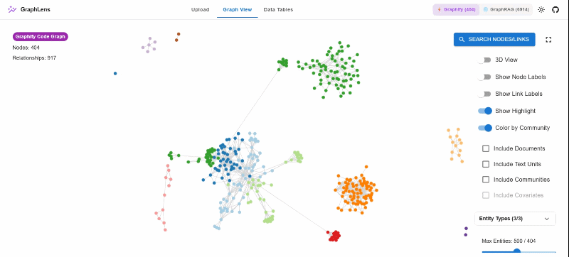

# GraphLens

> **Interactive 2D & 3D Dual-Engine Visualizer for Microsoft GraphRAG and Graphify Codebase Knowledge Graphs.**

[](LICENSE)
[](https://nodejs.org)



---

## Overview

**GraphLens** is an open-source, client-side knowledge graph visualizer designed to seamlessly explore both **Microsoft GraphRAG** LLM pipelines and **Graphify** codebase structural graphs. 

Everything runs directly in your browser using Web Workers and WebGL—ensuring zero setup, high performance, and complete data privacy without sending any files to external servers.

---

## Key Features

- **🌐 Dual-Engine Graph Support**:
  - **Graphify**: Visualize software architectures, AST call graphs, class hierarchies, file dependencies, and auto-detected communities.
  - **Microsoft GraphRAG**: Visualize entities, relationships, documents, text units, covariates, and community summaries from indexing pipelines.
- **🎨 2D & 3D Force-Directed Simulation**: Switch seamlessly between 2D canvas and 3D WebGL force-directed layouts with physics controls, link particles, and collision forces.
- **🔒 100% Client-Side Privacy**: Fast in-browser Parquet (via `hyparquet`) and JSON parsing. No backend required and no tracking telemetry.
- **🔍 Fuzzy Search & Node Inspection**: Instant symbol and entity search via `Fuse.js` with detail drawers showing connected neighbors and attributes.
- **📊 Interactive Data Tables**: Sort, filter, search, and paginate raw entities, relationships, communities, and reports using `material-react-table`.
- **🌓 Theme Support**: Built-in Dark and Light themes with responsive, glassmorphic UI.

---

## Supported File Formats

### 1. Graphify Codebase Graphs
Drag & drop your `graphify-out/` folder or individual files into GraphLens:

| File | Format | Status | Description |
| :--- | :--- | :--- | :--- |
| `graph.json` | JSON | **Required** | Complete AST code graph: nodes (functions, classes, modules), directional edges, communities, and file locations. |
| `GRAPH_REPORT.md` | Markdown | *Optional* | Unlocks the Architecture & God Nodes report tab with cohesion metrics and community summaries. |
| `manifest.json` | JSON | *Optional* | Unlocks the Files Manifest table showing source files, LoC, and extracted symbol counts. |
| `.graphify_labels.json` | JSON | *Optional* | Human-readable community cluster titles (falls back to `graph.json` community names). |

> **Tip**: You can also click **"Load Example Graphify Dataset"** on the upload screen to explore preloaded sample data immediately.

### 2. Microsoft GraphRAG Parquet Artifacts
Drag & drop your `.parquet` files or place them into `public/artifacts/`:

| GraphRAG v2.x | GraphRAG v1.x (Legacy) | Data Type | Description |
| :--- | :--- | :--- | :--- |
| `entities.parquet` | `create_final_entities.parquet` | Entities | Extracted named entities, semantic categories, and descriptions |
| `relationships.parquet` | `create_final_relationships.parquet` | Edges | Directed relationships between entities with weights |
| `documents.parquet` | `create_final_documents.parquet` | Documents | Source raw documents |
| `text_units.parquet` | `create_final_text_units.parquet` | Chunks | Text chunk units derived from documents |
| `communities.parquet` | `create_final_communities.parquet` | Clusters | Hierarchical communities detected across entities |
| `community_reports.parquet` | `create_final_community_reports.parquet` | Reports | LLM synthesis reports and findings per community |
| `covariates.parquet` | `create_final_covariates.parquet` | Claims | Extracted claim covariates |

> **Tip**: Click **"Load Example GraphRAG Dataset"** on the upload screen to test GraphRAG visualization without uploading any files.

---

## Graph Data Model

### Node Types

| Node Type | Engine | Description |
| :--- | :--- | :--- |
| `FUNCTION`, `CLASS`, `MODULE`, `INTERFACE` | **Graphify** | Code symbols extracted via AST analysis |
| `COMMUNITY` | **Graphify & GraphRAG** | Clustered module or semantic community |
| Extracted Semantic Types (*PERSON, ORG, GEO, etc.*) | **GraphRAG** | LLM-extracted domain entities |
| `RAW_DOCUMENT` | **GraphRAG** | Source raw documents |
| `CHUNK` | **GraphRAG** | Text chunk units with token counts |
| `FINDING` | **GraphRAG** | Key community findings and explanations |
| `COVARIATE` | **GraphRAG** | Claims, temporal metadata, and covariate entities |

### Relationship / Edge Types

| Source Node | Edge Type | Target Node | Engine | Description |
| :--- | :--- | :--- | :--- | :--- |
| Function / Class | `calls` | Function / Method | **Graphify** | Execution or invocation call |
| Module / Class | `contains` | Function / Class | **Graphify** | Structural hierarchy & membership |
| File / Module | `imports` | Module / Package | **Graphify** | Module import dependency |
| Class | `extends` | Base Class | **Graphify** | Class inheritance / interface implementation |
| Symbol | `references` | Symbol / File | **Graphify** | Variable, symbol, or type reference |
| Entity | `RELATED` | Entity | **GraphRAG** | Semantic relationship with weight |
| Text Unit | `PART_OF` | Document | **GraphRAG** | Chunk belongs to source document |
| Text Unit | `HAS_ENTITY` | Entity | **GraphRAG** | Text unit references extracted entity |
| Text Unit | `HAS_COVARIATE` | Covariate | **GraphRAG** | Text unit contains claim/covariate |
| Community | `HAS_FINDING` | Finding | **GraphRAG** | Community report links to finding |
| Entity / Symbol | `IN_COMMUNITY` | Community | **Both** | Node belongs to detected community cluster |

---

## Getting Started

### Prerequisites
- Node.js 18+
- npm or pnpm

### Installation

```bash
# Clone the repository
git clone https://github.com/rpdil23/GraphLens.git
cd GraphLens

# Install dependencies
npm install

# Start local development server
npm start
```

Visit `http://localhost:3000` in your browser.

### Building for Production

```bash
npm run build
```

The optimized bundle will be generated in `build/`.

### Deployment to GitHub Pages

```bash
npm run deploy
```

---

## Verification & Testing

```bash
# Typecheck TypeScript
npx tsc --noEmit

# Run unit tests
npm test -- --watchAll=false

# Test production build
npm run build
```

---

## Contributing

Contributions, bug reports, and suggestions are welcome!
1. Fork the repository.
2. Create your feature branch (`git checkout -b feat/my-feature`).
3. Commit your changes (`git commit -m 'feat: add my feature'`).
4. Push to the branch (`git push origin feat/my-feature`).
5. Open a Pull Request.

---

## Acknowledgements & Attribution

GraphLens is extended from the original [graphrag-visualizer](https://github.com/noworneverev/graphrag-visualizer) created by **Yan-Ying Liao** (`noworneverev`).

We express our gratitude to the original project and Microsoft GraphRAG team for the foundation that made this multi-source visualizer possible.

---

## License

This project is licensed under the [MIT License](LICENSE).
